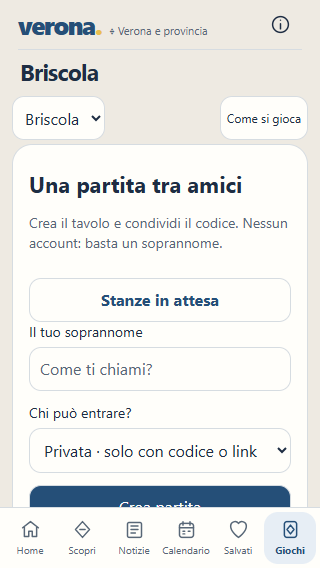
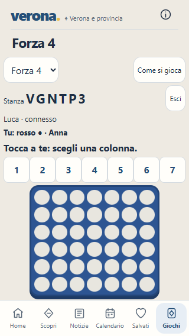
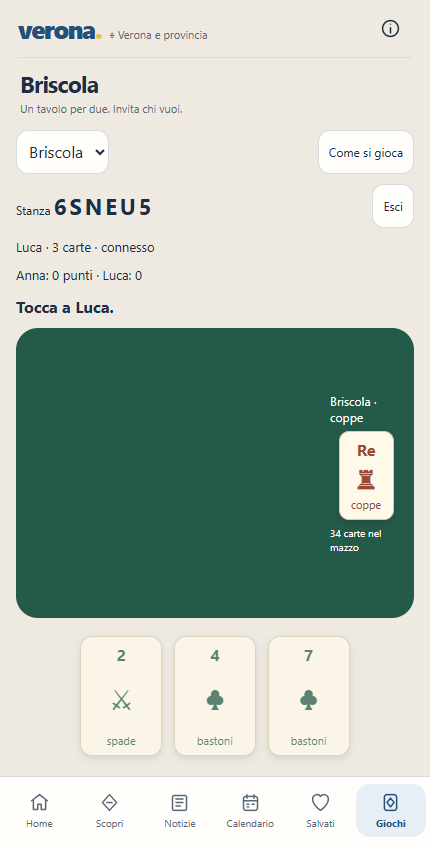

# Analisi grafica e tecnica dei giochi

**Verona · 19 ottobre 2026 · Briscola e Forza 4**

## Valutazione

La base funzionale è valida per un prototipo: le regole sono applicate dal server, le carte avversarie restano riservate, gli ingressi concorrenti sono controllati e i due giochi conservano sessioni distinte. La revisione individua soprattutto problemi di gerarchia visiva, leggibilità del turno e continuità della partita. Prima di aggiungere altri giochi conviene completare questi due.

La direzione proposta è una piccola sala giochi dentro Verona: ingresso breve, tavolo protagonista, avversario riconoscibile, azioni comprensibili e possibilità di giocare ancora con la stessa persona. L'identità dell'app — fondo caldo, blu delle azioni e navigazione inferiore — può restare. L'atmosfera del gioco va costruita nella superficie centrale.

Questo documento contiene la diagnosi e la specifica degli interventi. Le schermate sono quelle del prodotto attuale; non sono nuove interfacce già implementate.

## Metodo ed evidenze

- Ispezione di `public/briscola.js`, dei suoi stili e markup in `public/calendar.template.html`, di `scripts/briscola.mjs` e `scripts/forza4.mjs`.
- Due contesti browser Edge indipendenti, su un server di prova separato da quello dell'utente. Soprannomi e stanze delle prove sono dati sintetici.
- Ingresso misurato a 320 × 568, 375 × 667 e 430 × 844 px; partita e risultato a 320 px; Briscola anche a 430 px.
- Invito, ingresso, partita Forza 4 fino alla vittoria, avvio Briscola e interruzione delle richieste di aggiornamento dell'avversario per 14 secondi.
- Prove deterministiche del completamento di una presa e del limite delle richieste con più identità sullo stesso indirizzo di connessione.
- Suite corrente: **170 test superati, zero fallimenti**. Nessun errore JavaScript rilevato durante l'audit browser.

Le misure sono in [evidence.json](game-audit/2026-10-19/evidence.json). Le prove tecniche ripetibili sono in [probes.mjs](game-audit/2026-10-19/probes.mjs): eseguire `node docs/game-audit/2026-10-19/probes.mjs`.

La prova browser usa viewport mobili, non telefoni fisici. Non è un test di carico, una certificazione di accessibilità o una verifica su Safari/iOS. Le raccomandazioni di seguito sono distinte dalle osservazioni effettivamente riprodotte.

## Problemi prioritari

| Priorità | Evidenza attuale | Effetto | Intervento proposto |
|---|---|---|---|
| Alta | A 320 × 568 il pulsante Crea termina a y=529, sotto l'inizio della navigazione a y=507; Entra termina a y=689. A 375 px Entra resta sotto la navigazione. Il contenuto è raggiungibile scorrendo internamente. | L'ingresso sembra un modulo lungo; le azioni principali non sono tutte percepibili alla prima apertura. | Mostrare tre azioni brevi: Trova una partita, Crea un tavolo, Ho un codice. Aprire nome, visibilità e codice in pannelli dedicati. |
| Alta | In Forza 4 a 320 px i sette pulsanti occupano 308 px; le caselle sono larghe circa 26 px. Il centro del primo pulsante è spostato di 43 px rispetto alla prima colonna; l'ultimo ha lo scarto opposto. | La relazione fra comando e colonna non è immediata: il pulsante 1 è quasi sopra la seconda colonna. | Ridurre le righe sopra il tavolo e usare una superficie comune per tabellone e comandi. Conservare le aree da 44 px; se l'altezza non permette sette comandi allineati, usare un selettore di colonna con anteprima e un pulsante Inserisci da 44 px. |
| Alta | Dopo la seconda carta, il server raccoglie subito la presa. `lastTrick` conserva entrambe le carte, ma il frontend le nasconde appena esiste una nuova carta in `table`. | Il giocatore che riceve gli aggiornamenti ogni 2,5 secondi può non vedere le due carte della presa conclusa. | Introdurre un evento di presa identificabile, una breve fase di lettura e un accesso persistente a Ultima presa. La risincronizzazione deve ricostruire la fase corretta. |
| Alta, prima della pubblicazione | Il limite è di 240 richieste/minuto per `req.socket.remoteAddress`. La prova controllata con 12 identità sullo stesso indirizzo rifiuta la richiesta 241. | Giocatori sulla stessa rete condividono la quota. Se un hosting presenta un unico indirizzo di proxy, il problema coinvolge anche reti diverse. | Distinguere quote anonime e quote dei giocatori autenticati. Configurare esplicitamente gli eventuali proxy fidati, senza fidarsi indiscriminatamente di `X-Forwarded-For`. |
| Media | Durante la partita restano in primo piano selettore, regole, codice stanza grande, uscita, testo avversario, punteggio e turno su righe separate. | Lo spazio utile al gioco diminuisce; sul piccolo schermo Forza 4 diventa poco leggibile. | Testata compatta con giocatori e turno. Codice, visibilità e regole dentro il pannello Stanza. |
| Media | Le carte sono etichette con simboli Unicode: la coppa è una torre da scacchi e le spade sono incrociate. A 430 px il tavolo iniziale è quasi vuoto e la briscola occupa da sola il lato destro. | I semi e le figure non hanno ancora un'identità riconoscibile da gioco di carte. Il tavolo non racconta chi sta giocando. | Carte originali vettoriali con semi coerenti, valori agli angoli e figure leggibili; mazzo e briscola compatti; avversario con carte coperte e area di presa centrale. |
| Media | Il risultato offre “Chiudi e crea un'altra partita”, ma il pulsante esegue soltanto `leave` e cancella la stanza. | La promessa dell'azione non coincide con il comportamento. Per rigiocare bisogna creare e condividere di nuovo un invito. | Come correzione minima, rinominare l'azione. Come esperienza completa, introdurre Rivincita con consenso di entrambi e mantenimento della stanza. |
| Media | Con l'avversario senza aggiornamenti compare “riconnessione…”, ma manca una fase di abbandono. Con almeno un client che continua il polling, la stanza può restare attiva. | Una partita può restare ferma senza un esito comprensibile. | Distinguere attesa breve, connessione persa e avversario non rientrato; mostrare azioni di recupero e definire una politica di abbandono. Nessuna sconfitta automatica nella prima breve interruzione. |
| Media, prima di crescere | Ogni client richiede l'intero stato ogni 2,5 secondi. Il ciclo di pulizia scorre le stanze a ogni richiesta. | Latenza percepibile e lavoro ripetuto anche a partita immobile. Le dimensioni del server non dimostrano la capacità effettiva. | Misurare prima il comportamento, poi aggiornare su evento o versione cambiata, con heartbeat separato e recupero dello stato. Spostare la pulizia su un ciclo dedicato se il profilo lo giustifica. |

### Ingresso attuale a 320 px

### Forza 4 attuale a 320 px

### Briscola attuale a 430 px

## Specifica grafica e di interazione

### 1. Entrare in una partita

La schermata Giochi presenta due schede compatte, Briscola e Forza 4, ciascuna con un piccolo segno visivo, “2 giocatori” e una descrizione di una riga. Dopo la scelta, le azioni principali sono **Trova una partita** e **Invita un amico**; **Ho un codice** resta un'alternativa chiara. Non chiedere dati prima che la persona abbia scelto l'azione.

La creazione usa un pannello con nome e visibilità privata iniziale. Per trovare una partita si conserva l'elenco pubblico esistente, con stato vuoto utile e ingresso protetto dal server. I dati digitati si conservano durante la visita; la chiusura del pannello non invia richieste di ingresso o creazione. La memorizzazione del soprannome fra visite deve essere esplicita se introdotta.

### 2. Aspettare un avversario

Mostrare due posti al tavolo: Tu e In attesa. Il codice rimane copiabile e il link condivisibile; quando supportata, una condivisione nativa può affiancare Copia. La visibilità pubblica o privata deve essere immediata. Lo stato pubblico precisa che la stanza è visibile nell'elenco; quello privato invita a condividere il link.

Una stanza pubblica connessa non equivale necessariamente a un ospite presente al telefono. Occorre distinguere l'heartbeat tecnico dall'effettiva inattività della persona e definire quando rimuovere o far scadere un'attesa lasciata aperta.

### 3. Giocare a Briscola

- Avversario in alto, con nome, punti e numero corretto di carte coperte. Nessuna informazione aggiuntiva sulle carte nascoste.
- Tavolo verde con trama CSS leggera, area centrale per le due carte e mazzo/briscola leggibili senza dominare la schermata.
- Mano in basso, con tre carte interamente raggiungibili. Valore e seme leggibili anche senza affidarsi soltanto al colore. Nessuna informazione essenziale solo al passaggio del mouse.
- Un'unica indicazione principale: Tocca a te oppure Tocca a [nome]. Una carta giocata riceve un riscontro immediato, mentre l'esito definitivo resta quello del server.
- La presa conclusa mostra carte, vincitore e punti guadagnati. La transizione proposta dura circa 0,8–1,2 secondi, da verificare in prova d'uso, con riduzione del movimento e possibilità di rivedere l'ultima presa. Una semplice animazione locale non risolve gli eventi saltati dal polling.
- Carte SVG originali: quattro semi coerenti e figure riconoscibili. Evitare di copiare mazzi commerciali. Non serve aggiungere un pacchetto grafico pesante.

### 4. Giocare a Forza 4

Il tabellone è l'elemento dominante. Nome, colore e turno si leggono in una fascia compatta. I colori restano distinti anche mediante simboli o segni equivalenti. Gli ingressi delle colonne vanno visualmente associati ai comandi, con anteprima della colonna selezionata e indicazione di colonna piena.

La pedina nuova scende una sola volta per evento; l'aggiornamento della presenza non deve riavviare l'animazione. La vittoria evidenzia la combinazione conservando visibile tutto il tabellone. Tastiera e pulsanti devono permettere le stesse azioni del tocco. Non ridurre i bersagli interattivi sotto 44 px per far entrare il tabellone.

### 5. Terminare e rigiocare

Il risultato mostra vincitore o pareggio, riepilogo e due azioni distinte: **Rivincita** e **Torna ai giochi**. La rivincita richiede due consensi; finché ne manca uno compare “In attesa di [nome]”. Il server mescola nuovamente la Briscola o svuota Forza 4 soltanto dopo entrambi i consensi. Le vecchie mosse devono essere rifiutate anche se il contatore del nuovo incontro riparte: serve un identificativo di partita o una versione monotona della stanza.

Gli effetti devono essere brevi e coerenti: elevazione leggera al tocco, spostamento della carta, caduta della pedina e risultato. Niente effetti continui, lampeggi o suoni automatici. Eventuali suoni e vibrazioni richiedono un'impostazione disattivabile; rispettare `prefers-reduced-motion`.

## Affidabilità da completare

**Identità delle operazioni.** La versione della stanza impedisce una mossa duplicata basata su uno stato vecchio. Non recupera però una risposta di creazione o ingresso persa dopo l'esecuzione sul server: il client potrebbe non ricevere il token del posto già assegnato. Questa è una deduzione dal protocollo corrente, non una simulazione effettuata durante l'audit. Introdurre un identificativo di operazione e una strategia di risposta ripetibile con proprietà e scadenza ben definite.

**Connessione.** Una sola indicazione di connessione, distinta dal turno; retry con attesa progressiva, risincronizzazione prima di riabilitare le mosse e gestione della scheda in background. Uno stato di versione precedente non deve mai sostituire una risposta più recente. Le richieste devono poter essere annullate quando la vista cambia.

**Persistenza.** Le stanze sono ancora in memoria. Un riavvio le elimina. Per promettere ripresa oltre una breve disconnessione, salvare mazzo e mani sul server, stato del turno, versione/identificativo dell'incontro, risultato e sessioni con scadenza. Il browser non deve diventare fonte autorevole delle carte. La persistenza va progettata prima di introdurre più processi o repliche.

**Limiti e abuso.** Correggere il limite condiviso mantenendo protezioni su creazione, tentativi di ingresso ed elenco pubblico. Verificare nomi molto lunghi, tentativi di HTML, client che ignorano i pulsanti disabilitati e richieste concorrenti. L'uso di `textContent`, dei token casuali e dei controlli server attuali è una base utile da conservare.

**Codice e manutenzione.** Il client comune contiene trasporto, memoria, lobby e due renderer nello stesso file. Conviene separare i moduli per responsabilità quando si implementano gli stati nuovi. Gli stili dei giochi sono aggiunte successive al template: consolidarli durante il redesign, mantenendo `public/index.html` generato con `npm run build`. Nessuna necessità emersa di riscrivere l'intera app o introdurre subito un framework.

## Ordine degli interventi e criteri di accettazione

| Passaggio | Consegna | Verifica richiesta |
|---|---|---|
| 1. Spazio e ingresso | Scelta gioco e accessi brevi, moduli nei pannelli, testata compatta, controlli Forza 4 coerenti con le colonne. | A 320 × 568, 375 × 667 e 430 × 844 nessuno scorrimento della pagina; navigazione visibile; azione principale e intero campo di gioco raggiungibili; tocco minimo 44 px; prova con tastiera e nomi di 24 caratteri. |
| 2. Leggibilità delle mosse | Nuove carte/semi, aree giocatore, fase di presa, animazione pedina, ultima presa consultabile. | Due browser con latenza diversa vedono e comprendono la stessa mossa; un aggiornamento tardivo non salta il risultato; movimento ridotto verificato. |
| 3. Continuità | Risultato curato, rivincita consensuale, stato connessione e abbandono definito. | Vincita, sconfitta, pareggio, consenso annullato, avversario scollegato, reload durante presa/rivincita e vecchie mosse rifiutate. |
| 4. Preparazione online | Quote corrette, recupero di operazioni e persistenza scelta. | Più giocatori dietro lo stesso proxy non condividono erroneamente la quota; retry non crea posti orfani; riavvio rispetta la politica dichiarata. |
| 5. Capacità misurata | Prove progressive con 20, 100, 300 e 1.000 giocatori simulati. | Registrare p50/p95/p99, errori, CPU, memoria, byte trasferiti, tempo di propagazione mosse e recupero dopo picchi. Definire il piano hosting dai risultati, non dal solo numero di CPU. |

Il primo intervento consigliato è il passaggio 1 insieme alla leggibilità della presa: libera spazio, elimina ambiguità di interazione e rende più percepibile il gioco. Carte elaborate, classifiche e altri giochi non risolvono questi problemi strutturali.
