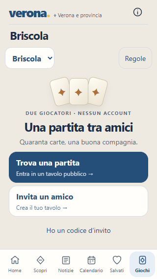
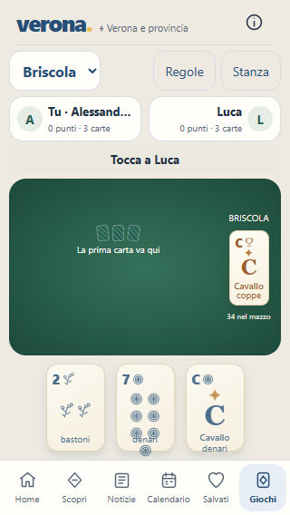
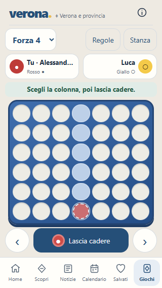
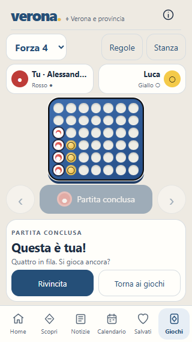

# Giochi Verona: analisi applicata e stato del redesign

**19 ottobre 2026 · Briscola e Forza 4**

Questa revisione descrive gli interventi applicati nell'app. La [diagnosi iniziale](analisi-giochi-iniziale.md) resta disponibile come riferimento storico.

## Interventi realizzati

| Area | Modifica applicata | Verifica |
|---|---|---|
| Ingresso | Trova una partita, Invita un amico e Ho un codice. Nome, visibilità e codice in pannelli dedicati. | Azioni visibili sopra la navigazione a 320 × 568, 375 × 844, 430 × 844 e 1.024 × 844; pannelli annullabili senza invio; valori conservati durante la visita. |
| Stanza | Codice e informazioni nel pannello Stanza. Attesa con due posti, codice e invito condivisibile; visibilità esplicita. | Creazione pubblica, ingresso dall'elenco e invito su due browser. Condivisione nativa se disponibile, copia come alternativa. |
| Tavolo | Testata compatta con nomi, punti o colore, presenza avversario e indicazione del turno. L'intestazione della pagina lascia spazio al gioco durante la sessione. | Mano e campo sopra la navigazione a 320 px; nomi lunghi; nessuno scorrimento della pagina. |
| Briscola | Semi SVG originali, valori agli angoli, simboli distribuiti nelle carte numeriche e figure distinte da iniziale e nome. Tavolo verde e carte avversarie coperte. | Partita a due browser e controllo visivo a 320 e 430 px. Le figure sono stilizzate, senza ritratti illustrati. |
| Presa | Identificativo e punti; pausa server di 1,2 secondi prima della prossima mossa; breve fase di lettura nel client. Ultima presa consultabile in un pannello. | Blocco fino a 1.199 ms e ripresa a 1.200 ms; pannello con entrambe le carte, punti e vincitore. |
| Forza 4 | Tocco per selezionare la colonna, corsia e pedina di anteprima; frecce grandi e Lascia cadere. Tabellone ampliato. | Tocco senza mossa involontaria, tastiera, colonna piena, vittoria e movimento ridotto. |
| Risultato | Vincita, sconfitta e pareggio distinti; riepilogo, Rivincita e Torna ai giochi. | Risultato Forza 4 su due browser; regole di vittoria e pareggio nei test server. |
| Rivincita | Due consensi, richiesta annullabile, codice e posti conservati. Nuovo identificativo d'incontro e versione della stanza monotona. | Voto singolo, annullamento, doppio consenso, stato azzerato e vecchie mosse rifiutate. Entrambi i giochi nei test server; flusso browser completo su Forza 4. |
| Quote | Ogni giocatore autenticato ha una quota distinta dagli altri sullo stesso indirizzo. | 12 identità valide dietro lo stesso proxy simulato e 300 letture complessive ammesse. Token inventati nella quota anonima. |
| Connessione | Retry con attesa crescente fino a 15 secondi, messaggio di recupero e mosse disabilitate dopo un errore di sincronizzazione rilevato. Stati di versione precedente scartati. | Revisione del flusso e controlli di sessione. Non introduce abbandono automatico o persistenza oltre il riavvio. |
| Stili | CSS consolidato in `public/games.css` e incorporato dalla build. | `npm run build` produce `public/index.html` senza nuove richieste per scaricare gli stili. |

## Schermate dopo gli interventi

### Ingresso a 320 px

### Briscola a 320 px

### Forza 4 a 320 px

### Risultato e rivincita

## Cosa rimane da fare

1. **Persistenza.** Stanze e sessioni server sono ancora nella memoria di un singolo processo. Un riavvio le cancella; il token nel browser non basta a recuperarle. Più repliche indipendenti non sono supportate.
2. **Risposte perse.** Una risposta di creazione o ingresso persa dopo l'esecuzione può lasciare un posto assegnato senza token ricevuto. Serve una strategia di operazioni identificabili e ripetibili; la versione delle mosse non risolve questo caso.
3. **Abbandono e presenza.** La presenza dipende dall'ultimo contatto del browser. Non esistono scadenza del turno o resa per mancato rientro; un heartbeat non dimostra che la persona sia davanti al telefono.
4. **Trasporto e cronologia.** Resta il polling ogni 2,5 secondi. Pausa e Ultima presa migliorano la lettura, ma non sono una cronologia completa: disconnessioni lunghe possono saltare prese intermedie. Valutare aggiornamenti su evento o versione cambiata e recupero degli eventi mancanti.
5. **Quote anonime e hosting.** Creazione, ingresso ed elenco senza identità valida condividono ancora la quota per indirizzo. Dietro un proxy configurazione e soglie vanno definite per l'hosting scelto, senza fidarsi di intestazioni inoltrate da chiunque.
6. **Telefoni reali e accessibilità.** Restano iOS/Safari, tastiere virtuali, VoiceOver/TalkBack, contrasto e reti mobili reali. Le verifiche di viewport e tastiera non sostituiscono queste prove.
7. **Capacità.** Non è stato eseguito un test di carico. Misurare p95/p99, errori, CPU, memoria e traffico con 20, 100, 300 e 1.000 utenti simulati prima di dimensionare l'hosting.

## Verifiche e limiti

Suite corrente: **180 test superati, zero fallimenti**. Nuovi test per pausa della presa, rivincita di entrambi i giochi, versioni degli incontri e separazione delle quote delle identità valide.

Collaudo Edge con due contesti indipendenti e dati sintetici su un server separato: ingresso, annullamento, stanze pubbliche, invito, consultazione della presa, partita Forza 4 completa, annullamento della rivincita e doppio consenso. Nessun errore JavaScript nei flussi provati. Verificata anche la disposizione dei sette simboli dentro la carta a 320 px.

Il frontend è stato rigenerato dai sorgenti. Pausa e rivincita richiedono il servizio Node aggiornato: il solo frontend non cambia le regole caricate da un processo già attivo.

La prossima priorità prima della pubblicazione è il recupero delle operazioni e la persistenza. La prossima verifica grafica è su telefoni reali, soprattutto con tastiera aperta e testo ingrandito.
